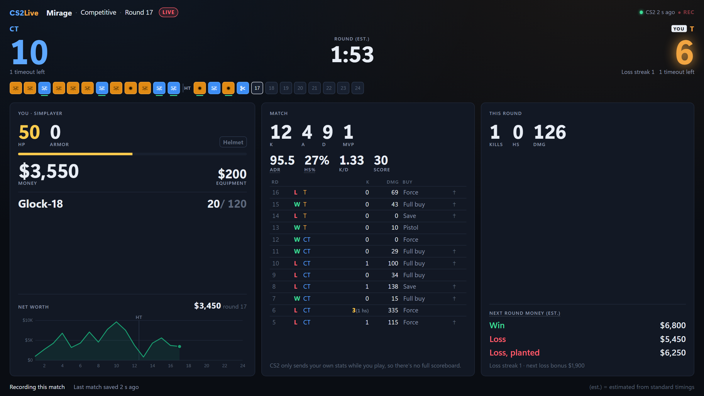
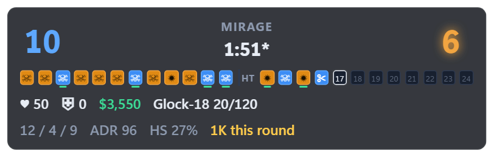
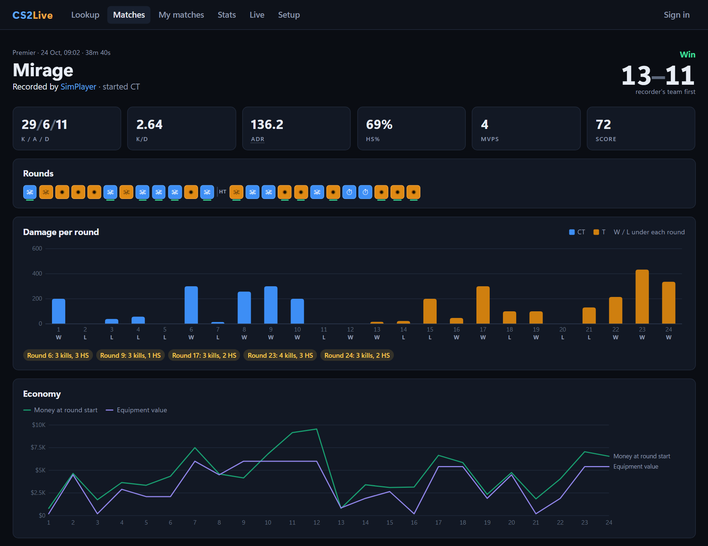
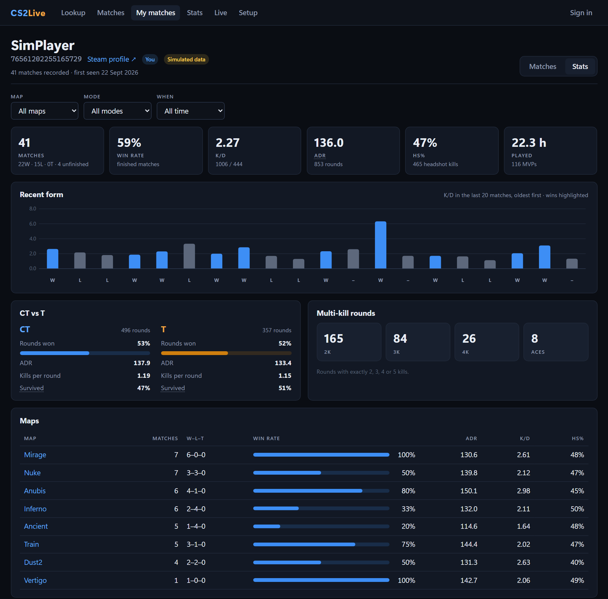
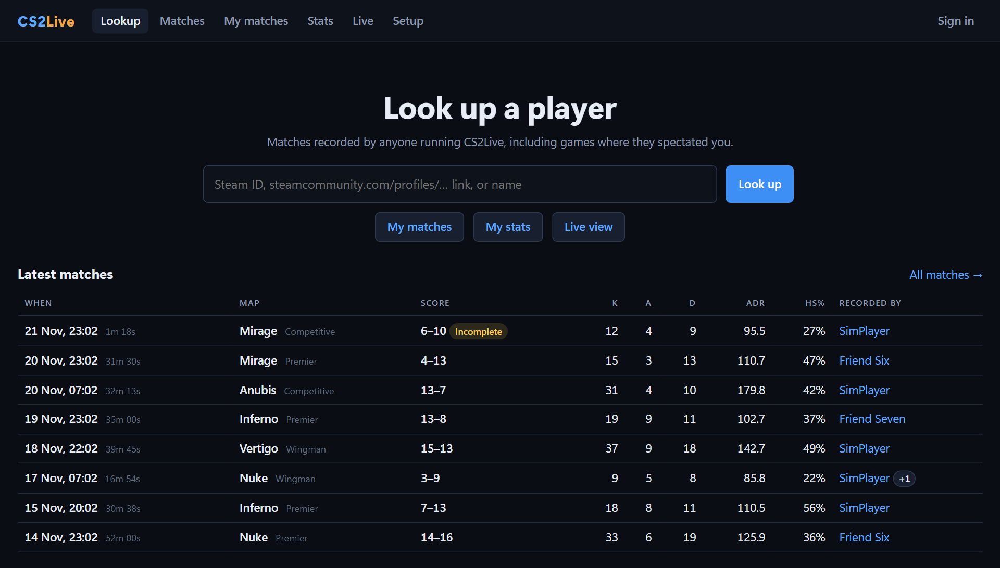
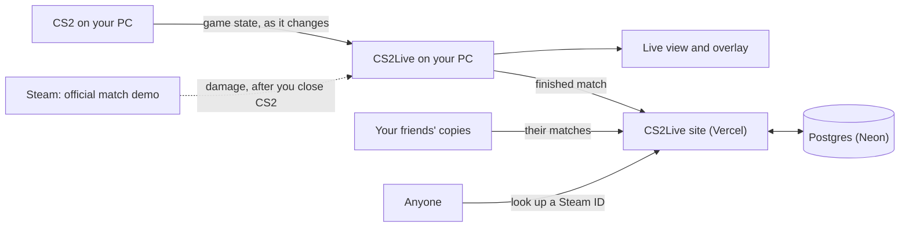

<div align="center">

# CS2Live

**Your Counter-Strike 2 matches, live on your second screen and saved round by round.**

A small app that runs next to CS2, shows what's happening in your match as you play, and keeps
every game, with your damage, economy and stats, on a site your friends can look you up on.


[What you get](#what-you-get) · [Quick start](#quick-start) ·
[Playing with friends](#playing-with-friends) · [Hosting the site](#hosting-the-site)

</div>

<br>



<p align="center"><sub>The live view, mid-match. All screenshots use simulated matches.</sub></p>

## What you get

- 🖥️ **A live dashboard** for your second monitor: score, round history, health, money, your
  weapon, kills and ADR, your net worth over the match and what you'll have next round.
- 🎥 **A stream overlay** for OBS, a compact card with the same essentials.
- 📼 **Every match saved**, round by round: who won each round and how, your kills, damage,
  buy and money. Quit early or crash? It's kept as _incomplete_ and picks up again if you
  reconnect.
- 💥 **Real damage numbers.** After a Premier, Competitive or Wingman match, CS2Live fetches
  the official match demo and reads your damage from it.
- 🎬 **Demos to rewatch.** Those demos are kept in CS2's replay folder, ready for `playdemo`.
- 📈 **Stats over time**: win rate by map and mode, CT vs T, buy types, multi-kills, weapons
  and recent form.
- 👥 **Shared with friends.** Everyone runs their own copy and uploads to one site, where anyone
  can look up a Steam ID.

## A quick tour

### While you play

The live view (top of this page) is made for a second monitor. For streaming, add the overlay to
OBS as a Browser Source:

<p align="center">
  
</p>

### After the match

Each match gets its own page: the result, your round-by-round damage with standout rounds
called out, your economy across the game, and a full round-by-round table.



### Over time

Your stats page brings it all together, filterable by map, mode and time.



### Look anyone up

The public site lists the latest matches from everyone using it. Search for a Steam ID to see
someone's games, including ones where a friend spectated them.



## How it works

CS2 has a built-in feature called **Game State Integration** (GSI): give it a small config file
and it posts the state of your game to a local web address whenever something changes (up to
ten times a second). CS2Live listens on that address.



- **Live tracking runs on your PC.** CS2 can only post to your own machine, and the live view
  needs a program that stays running.
- **The site holds the history.** Your copy uploads each finished match with your personal
  upload key. Only the site needs the database password.
- **Nothing is lost.** Finished matches wait in `.cs2live/outbox/` until they're saved, so a
  network blip or a site outage just delays them.

> [!NOTE]
> **CS2 only tells you about you.** While you play, GSI sends your own state, the team scores and
> round results. It sends a teammate's state only while you're dead and spectating them, and
> never anything about enemies. So there's no 10-player scoreboard. Teammates you spectate are
> saved as _partial sightings_, so they can still find those games.
>
> Some numbers are worked out rather than reported (kills per weapon, buy type, the round
> timer). The app underlines these with dots, and [`STATS.md`](STATS.md) explains how every
> number is calculated.

## Quick start

You'll need [Node.js](https://nodejs.org) 22.18 or newer, [Yarn 1](https://classic.yarnpkg.com)
and CS2. CS2Live is built and tested on Windows.

**1. Install**

```sh
git clone https://github.com/flooyd/cs2live.git
cd cs2live
yarn install
cp .env.example .env
```

**2. Connect CS2**

```sh
yarn gsi:config --install
```

This writes the GSI config (with a fresh secret token) and copies it into CS2's `cfg` folder.
Then **restart CS2**: it only reads these configs at startup.

**3. Start CS2Live**

```sh
yarn live
```

Open <http://localhost:5173/setup>, enter your Steam ID and check that CS2 is sending data. Then
open <http://localhost:5173/live> on your second screen and play.

To keep a match history, CS2Live needs somewhere to save it: a CS2Live site (a friend's, see
below, or [your own](#hosting-the-site)), or a Postgres database of your own in `DATABASE_URL`.
Until then, finished matches wait safely in the outbox.

> [!TIP]
> No CS2 handy? Run `yarn dev`, then replay a recorded match into it:
> `yarn gsi:replay fixtures/synthetic/full-match.ndjson --speed 20 --as <your Steam ID>`

## While you play

| Page                                        | What it's for                                                                                |
| ------------------------------------------- | -------------------------------------------------------------------------------------------- |
| [`/live`](http://localhost:5173/live)       | The full-screen live view for a second monitor.                                              |
| [`/overlay`](http://localhost:5173/overlay) | A transparent card for OBS. Add it as a Browser Source; `?scale=1.5` makes it bigger.        |
| [`/setup`](http://localhost:5173/setup)     | Your Steam ID, a check that CS2 is sending data, where matches are saved, and demo settings. |

A match is saved when it reaches the scoreboard. If you leave, crash or alt-F4, it's saved as
_incomplete_ after two minutes, and continues as the same match if you reconnect.

### Damage and demos

CS2 doesn't send damage while you play, but Valve keeps a demo of every official match. After a
Premier, Competitive or Wingman match, **once you've closed CS2**, CS2Live asks Steam for the
demo, reads your damage from it and updates the match. Steam needs to be running, and it will
show you as "playing CS2" for a few seconds while it asks.

- **Watch them later.** Demos are saved in CS2's `replays` folder under CS2's own names. Each
  match page (and `/setup`) has the `playdemo` command to paste into CS2's console.
- **Import older games.** **Import recent matches** on `/setup` adds the official matches Steam
  still lists that CS2Live didn't record, built entirely from their demos.
- **Steam only lists your last few matches**, so close CS2 now and then.
- Don't want any of this? Untick **Fill in damage from match demos** on `/setup`.

## Playing with friends

Each friend runs their own copy and uploads to one shared site.

1. **The site owner** adds the friend's email to `SIGNUP_ALLOWLIST` on Vercel.
2. **The friend** signs up on the site, opens **Account**, claims their Steam ID and creates an
   **upload key** (it's shown once, so copy it).
3. They install CS2Live with the [quick start](#quick-start) above.
4. On their local `/setup` page they enter their Steam ID, the site's URL and the upload key.
   **Test connection** checks that the key works.

From then on every finished match uploads automatically. If the site is down CS2Live retries
with a growing delay; if the key is wrong or revoked, uploads pause until a new one is saved.

## Hosting the site

The public site runs on [Vercel](https://vercel.com) with a [Neon](https://neon.tech) Postgres
database. Live tracking switches itself off there.

<details>
<summary><b>Step-by-step: Vercel + Neon</b></summary>

1. Create a Neon database. Vercel's Neon integration sets `DATABASE_URL` (pooled) and
   `DATABASE_URL_UNPOOLED` (direct) for you.
2. Import the repo into Vercel (framework: SvelteKit) and set:

   | Variable                | Value                                                                                      |
   | ----------------------- | ------------------------------------------------------------------------------------------ |
   | `DATABASE_URL`          | Neon pooled URL (`…-pooler…/neondb?sslmode=require`)                                       |
   | `DATABASE_URL_UNPOOLED` | Neon direct URL, used for migrations                                                       |
   | `BETTER_AUTH_SECRET`    | 32+ random characters                                                                      |
   | `ORIGIN`                | The site's URL, e.g. `https://cs2live.vercel.app`                                          |
   | `SIGNUP_ALLOWLIST`      | Emails allowed to sign up, comma-separated (`*` = anyone). Empty = only the first account. |

3. Put the Neon URLs in your local `.env` and run the migrations: `yarn db:migrate`. Do this
   again before deploying a change that adds a migration.
4. Open the site, sign up (the first account is always allowed), claim your Steam ID and create
   an upload key. Enter the site URL and key on your local `/setup`.

As the site owner you can instead put `DATABASE_URL` in your local `.env`: your copy then writes
straight to the database and needs no upload key.

</details>

## Good to know

- **No enemy data, no full scoreboard.** GSI only describes you and whoever you spectate. Kills
  per weapon and headshots are inferred from your own counters as they change.
- **Damage needs the demo.** Until it's fetched (or for unofficial matches), damage shows as
  unknown rather than zero.
- **Custom profile URLs** (`/id/name`) can't be resolved without a Steam Web API key. Search by
  SteamID64 or a `/profiles/7656…` link; names work for players the site already knows.
- **Steam IDs aren't verified.** The first account to claim one gets it. That's fine among
  friends; a public site would want Steam login.

## Development

<details>
<summary><b>Commands</b></summary>

| Command                   | What it does                                                          |
| ------------------------- | --------------------------------------------------------------------- |
| `yarn dev`                | Dev server on :5173, live tracking included                           |
| `yarn live`               | Local production build (adapter-node) on :5173 for real play          |
| `yarn build`              | Vercel build (history, stats, upload API; no live tracking)           |
| `yarn gsi:config`         | Generate (and with `--install`, install) the CS2 GSI config           |
| `yarn gsi:replay <file>`  | Replay a GSI capture or fixture into a running server                 |
| `yarn gsi:anonymise`      | Trim and anonymise a real capture into a fixture                      |
| `yarn gsi:fixtures`       | Regenerate the synthetic fixtures from the simulator                  |
| `yarn demo:damage`        | Read the damage for a Steam ID from a demo (`<demo\|latest> <id>`)    |
| `yarn run check`          | svelte-check (note: `yarn check` is yarn's own, unrelated command)    |
| `yarn lint` / `yarn test` | Prettier + ESLint / Vitest                                            |
| `yarn verify:replay`      | End-to-end check: replay a fixture, expect exactly one saved match    |
| `yarn db:generate`        | Generate a SQL migration from the drizzle schema                      |
| `yarn db:migrate`         | Apply migrations (uses `DATABASE_URL_UNPOOLED` when set)              |
| `yarn db:seed`            | Fill a dev database with simulated matches (`--reset` removes them)   |
| `yarn db:cleanup`         | Delete stored raw payloads older than 30 days (`--days`, `--dry-run`) |
| `yarn db:studio`          | Drizzle Studio                                                        |

</details>

<details>
<summary><b>Working on CS2Live</b></summary>

- **Stack:** SvelteKit 3 with Svelte 5, TypeScript, drizzle-orm on Postgres, better-auth, zod
  and Vitest. Demos are parsed with `@laihoe/demoparser2`.
- **No CS2 needed.** Replay a fixture (`yarn gsi:replay fixtures/synthetic/full-match.ndjson
--speed 20`) and seed a database (`yarn db:seed`) to work on any page.
- **Tests.** `yarn test` runs the unit tests. The database tests (`*.db.spec.ts`) also need
  `TEST_DATABASE_URL`: any Postgres database whose name contains `test` (its tables are
  emptied). Without it they're skipped.
- **Real captures help.** `GSI_CAPTURE=1` records every payload to `captures/`. See
  [`fixtures/README.md`](fixtures/README.md) for how to anonymise and share one.
- **Measured vs guessed:** [`STATS.md`](STATS.md) defines every number and tags it observed,
  derived, inferred, estimated or partial.
- **Windows:** `yarn build` needs Developer Mode (the Vercel adapter creates symlinks). Vercel
  itself builds on Linux.
- Notes for Claude Code (conventions and project skills) live in [`CLAUDE.md`](CLAUDE.md) and
  `.claude/skills/`.

</details>
